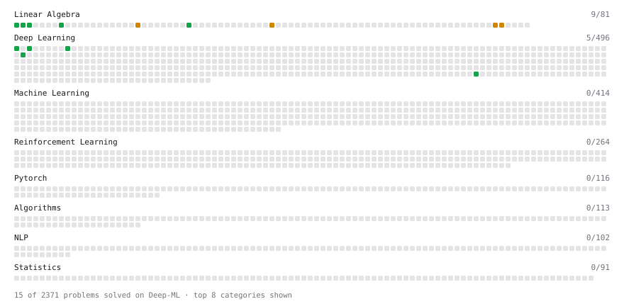

# Deep-ML

My machine learning practice from [Deep-ML](https://www.deep-ml.com). Every solution here was written by hand.

**27** solved · 17 problems · 0 labs · 10 math

[**Browse the interactive portfolio**](https://iam-dev-Adarsh.github.io/deep-ml/) to replay this filling in over time.

## Problems

| | Difficulty | Solved | |
| --- | --- | --- | --- |
| [Calculate 2x2 Matrix Inverse](https://www.deep-ml.com/problems/8) | easy | 2026-11-18 | [solution](problems/0008-calculate-2x2-matrix-inverse) |
| [Calculate Number of Parameters in Neural Network](https://www.deep-ml.com/problems/371) | easy | 2026-11-15 | [solution](problems/0371-calculate-number-of-parameters-in-neural-network) |
| [Dot Product Calculator](https://www.deep-ml.com/problems/83) | easy | 2026-11-16 | [solution](problems/0083-dot-product-calculator) |
| [Implement ReLU Activation Function](https://www.deep-ml.com/problems/42) | easy | 2026-11-15 | [solution](problems/0042-implement-relu-activation-function) |
| [Matrix-Vector Dot Product](https://www.deep-ml.com/problems/1) | easy | 2026-11-15 | [solution](problems/0001-matrix-vector-dot-product) |
| [Reshape Matrix](https://www.deep-ml.com/problems/3) | easy | 2026-11-14 | [solution](problems/0003-reshape-matrix) |
| [Run the Digit Network Forward](https://www.deep-ml.com/problems/1994) | easy | 2026-11-15 | [solution](problems/1994-run-the-digit-network-forward) |
| [Sigmoid Activation Function Understanding](https://www.deep-ml.com/problems/22) | easy | 2026-11-14 | [solution](problems/0022-sigmoid-activation-function-understanding) |
| [Single Neuron](https://www.deep-ml.com/problems/24) | easy | 2026-11-14 | [solution](problems/0024-single-neuron) |
| [Transpose of a Matrix](https://www.deep-ml.com/problems/2) | easy | 2026-11-16 | [solution](problems/0002-transpose-of-a-matrix) |
| [Cholesky Decomposition](https://www.deep-ml.com/problems/334) | medium | 2026-11-22 | [solution](problems/0334-cholesky-decomposition) |
| [Find Captain Redbeard's Hidden Treasure](https://www.deep-ml.com/problems/127) | medium | 2026-11-15 | [solution](problems/0127-find-captain-redbeard-s-hidden-treasure) |
| [Gaussian Elimination for Solving Linear Systems](https://www.deep-ml.com/problems/58) | medium | 2026-11-22 | [solution](problems/0058-gaussian-elimination-for-solving-linear-systems) |
| [LU Decomposition of a Square Matrix](https://www.deep-ml.com/problems/333) | medium | 2026-11-22 | [solution](problems/0333-lu-decomposition-of-a-square-matrix) |
| [Partitioned Inverse via Schur Complements](https://www.deep-ml.com/problems/1775) | medium | 2026-11-18 | [solution](problems/1775-partitioned-inverse-via-schur-complements) |
| [Woodbury, Sherman-Morrison and the Determinant Lemma](https://www.deep-ml.com/problems/1774) | medium | 2026-11-22 | [solution](problems/1774-woodbury-sherman-morrison-and-the-determinant-lemma) |
| [QR Decomposition](https://www.deep-ml.com/problems/201) | hard | 2026-11-22 | [solution](problems/0201-qr-decomposition) |

## Math

| | Difficulty | Solved | |
| --- | --- | --- | --- |
| [Derivatives and Gradients](https://www.deep-ml.com/math-problems/1) | easy | 2026-11-15 | [solution](math/0001-derivatives-and-gradients) |
| [Matrix Basics](https://www.deep-ml.com/math-problems/9) | easy | 2026-11-16 | [solution](math/0009-matrix-basics) |
| [Vector Operations](https://www.deep-ml.com/math-problems/7) | easy | 2026-11-16 | [solution](math/0007-vector-operations) |
| [Condition Numbers: Why the Determinant Lies About Near-Singularity](https://www.deep-ml.com/math-problems/412) | medium | 2026-11-22 | [solution](math/0412-condition-numbers-why-the-determinant-lies-about-near-singularity) |
| [Inverse and Rank](https://www.deep-ml.com/math-problems/12) | medium | 2026-11-18 | [solution](math/0012-inverse-and-rank) |
| [Matrix Multiplication](https://www.deep-ml.com/math-problems/10) | medium | 2026-11-15 | [solution](math/0010-matrix-multiplication) |
| [Schur Complements and the Partitioned Inverse](https://www.deep-ml.com/math-problems/409) | medium | 2026-11-18 | [solution](math/0409-schur-complements-and-the-partitioned-inverse) |
| [Solving Linear Systems](https://www.deep-ml.com/math-problems/13) | medium | 2026-11-22 | [solution](math/0013-solving-linear-systems) |
| [Woodbury, Sherman-Morrison and the Matrix Determinant Lemma](https://www.deep-ml.com/math-problems/410) | medium | 2026-11-18 | [solution](math/0410-woodbury-sherman-morrison-and-the-matrix-determinant-lemma) |
| [Matrix Decompositions: LU and QR](https://www.deep-ml.com/math-problems/15) | hard | 2026-11-22 | [solution](math/0015-matrix-decompositions-lu-and-qr) |

---

_This file is regenerated by Deep-ML on every push._
